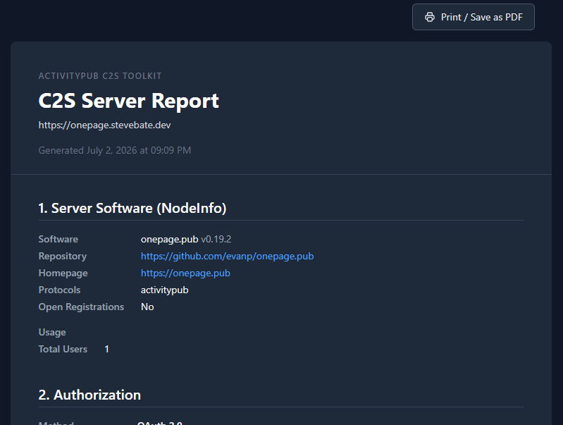
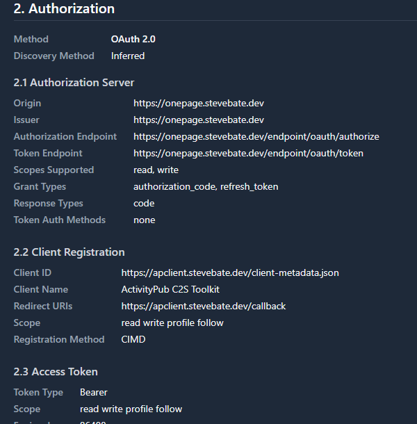
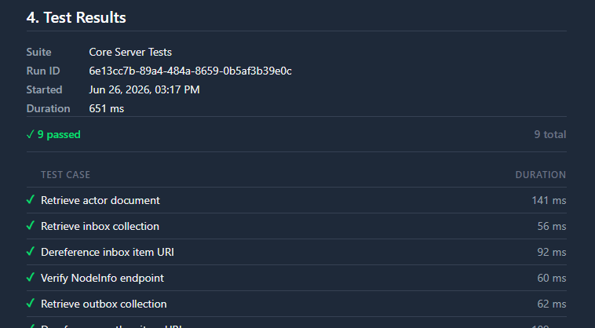

## Server Capability Reports

A printable report describing capabilities and test results can be generated for a server. To generate a report, use the "Server Reports" option in the server menu.

### Server Overview

The section provides general information about the server (NodeInfo metadata, actor endpoints, etc.)

### OAuth2 Details

This ection of the report provides details about the OAuth2 flow for the server, including the specific methods used in various authorization steps. This also includes information about the actor that was authorized and how that actor was discovered.

### Test Results

This section provides information the results of running the C2S Server tests from the test client.

## Server Capabilities Data Export

The servers table has an "Export JSON" button that can export many details about a C2S server (capabilities, test results, etc.). This can be useful for custom reporting like server comparison tables.